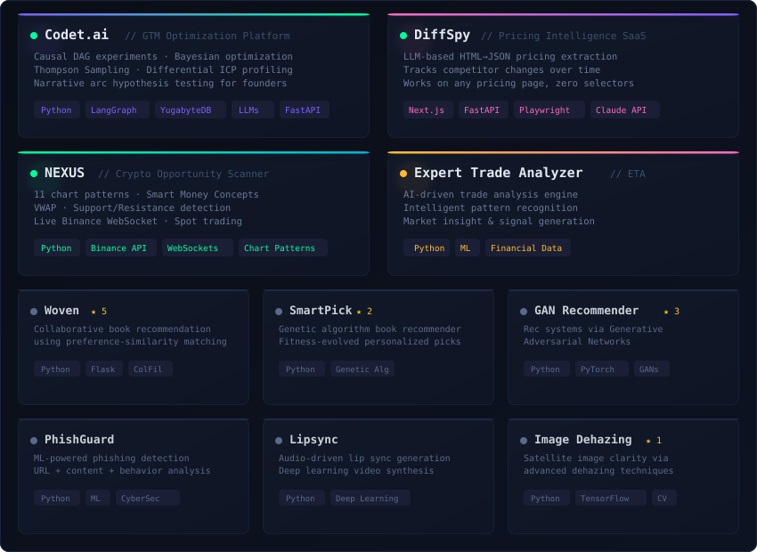
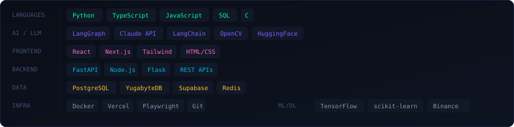
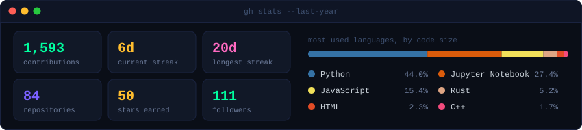

  <picture>
    <source media="(prefers-color-scheme: dark)" srcset="./assets/hero-dark.svg"/>
    <source media="(prefers-color-scheme: light)" srcset="./assets/hero-light.svg"/>
    
  </picture>

  

    <a href="https://www.linkedin.com/in/ayesha-irshad/">linkedin</a> ·
    <a href="mailto:ayeshaitshad124@gmail.com">email</a> ·
    <a href="https://github.com/AyeshaIrshad1337?tab=repositories">repositories</a>
    &nbsp;
    
  

## `> ./projects --all`

  

## `> cat /etc/stack.conf`

  

## `> gh stats --last-year`

  <picture>
    <source media="(prefers-color-scheme: dark)" srcset="./assets/stats-dark.svg"/>
    <source media="(prefers-color-scheme: light)" srcset="./assets/stats-light.svg"/>
    
  </picture>

  
  
  

 

  <picture>
    <source media="(prefers-color-scheme: dark)" srcset="https://raw.githubusercontent.com/AyeshaIrshad1337/AyeshaIrshad1337/output/github-snake-dark.svg"/>
    <source media="(prefers-color-scheme: light)" srcset="https://raw.githubusercontent.com/AyeshaIrshad1337/AyeshaIrshad1337/output/github-snake.svg"/>
    
  </picture>

 

  

